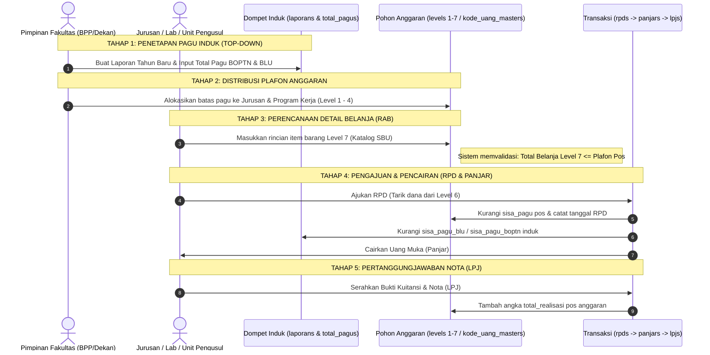

# Alur Proses Bisnis & Distribusi Anggaran Kasidoi

Dokumen ini menjelaskan alur distribusi anggaran secara menyeluruh: dari penetapan total pagu pusat di tingkat fakultas, pembagian jatah ke level-level program/kegiatan, hingga proses pencairan dana dan pertanggungjawaban nota belanja riil.

---

## 1. Analogi Distribusi Air (Ember Raksasa ke Gelas-Gelas Kecil)

Agar mudah dibayangkan, alur keuangan kampus ini bekerja mirip pembagian air:

```
[Total Pagu / Laporan]  --> Ember Raksasa Fakultas (Total Dana BOPTN & BLU)
         ↓
  [Level 3 / Jurusan]   --> Ember Sedang (Jatah Per Jurusan/Prodi)
         ↓
  [Level 4 / Program]   --> Teko Wadah Program (Misal: Penguatan Lab Jaringan)
         ↓
 [Level 6 / Pos Beban]  --> Gelas Pos Belanja (Akun Tempat RPD Diajukan)
         ↓
 [Level 7 / Rincian]    --> Tetesan Air / Pengeluaran Riil (Item Barang Katalog SBU)
```

> **Hukum Utama:**  
> 1. Tetesan air (kuitansi belanja) hanya bisa keluar jika gelasnya (pos belanja) masih punya saldo.  
> 2. Total air di semua gelas dan teko tidak boleh melebihi isi ember raksasa (Pagu Induk).

---

## 2. Diagram Alur Proses Bisnis (End-to-End Flow)



---

## 3. Penjelasan Lengkap Tahapan Bisnis & Pemetaan Penyimpanan Data

Berikut adalah detail apa yang terjadi di setiap langkah, siapa yang bertindak, dan **ke tabel & kolom mana data tersebut disimpan di database**:

### 🔹 Tahap 1: Pembukaan Buku Anggaran & Penetapan Pagu Induk
* **Penjelasan Proses**:
  Di awal tahun anggaran, Pimpinan Fakultas (BPP / Bagian Perencanaan) membuka buku laporan baru untuk tahun berjalan (misal: Tahun 2026). Mereka memasukkan total batas uang yang diterima fakultas dari pemerintah pusat (BOPTN) dan target penerimaan mandiri kampus (BLU).
* **Data Disimpan Ke Mana?**:
  1. **Tabel `laporans`**:
     - `nama_laporan`: Nama buku anggaran (misal: *"Anggaran Operasional Fatek 2026"*).
     - `tahun`: Tahun anggaran (misal: `2026`).
     - `pagu_boptn`: Batas pagu BOPTN (misal: `1000000000`).
     - `sisa_pagu_boptn`: Saldo awal disamakan dengan `pagu_boptn`.
     - `pagu_blu`: Batas pagu BLU (misal: `2000000000`).
     - `sisa_pagu_blu`: Saldo awal disamakan dengan `pagu_blu`.
     - `status`: Status aktif laporan (`"ACTIVE"` / `"enable"`).
  2. **Tabel `total_pagus`**:
     - `id_laporan`: Relasi ke buku laporan yang bersangkutan.
     - `pagu_awal`: Total gabungan dana awal.
     - `sisa_pagu`: Sisa saldo total yang belum terikat transaksi.

---

### 🔹 Tahap 2: Distribusi Plafon Anggaran ke Unit / Jurusan (Top-Down)
* **Penjelasan Proses**:
  Fakultas tidak memakai uangnya sendiri sekaligus, melainkan membagikannya ke unit-unit di bawahnya (Jurusan Mesin, Sipil, Elektro, Informatika, Arsitektur, dll). Pimpinan membuat cabang pohon anggaran (Level 1 sampai Level 4) dan memberikan jatah plafon maksimal untuk setiap jurusan.
* **Data Disimpan Ke Mana?**:
  1. **Tabel Struktur Hierarki (`levels_1`, `levels_2`, `levels_3`, `levels_4`)**:
     - `kode_uang`: Kode MAK atau kode pos anggaran (misal: `01.02.04`).
     - `nama`: Nama unit / program (misal: *"Jurusan Teknik Informatika"*).
  2. **Tabel `rabs` & `kode_uang_masters`**:
     - `pagu_awal`: Batas nominal pagu yang dijatahkan ke program tersebut.
     - `sisa_pagu`: Saldo pagu yang masih tersedia untuk dibelanjakan.

---

### 🔹 Tahap 3: Penyusunan Rincian Belanja / Usulan RAB (Bottom-Up)
* **Penjelasan Proses**:
  Setelah Jurusan tahu jatah plafon anggarannya, Kepala Lab / Ketua Jurusan menjabarkan rencana belanja secara rinci hingga ke level barang/jasa riil (Level 6 & Level 7). Harga satuan barang tidak boleh dikarang bebas, melainkan harus memilih dari katalog standar biaya resmi (SBU).
* **Data Disimpan Ke Mana?**:
  1. **Tabel `levels_6`**:
     - Pos beban tempat RPD akan diajukan (misal: *"Akun 52: Pengadaan Bahan Lab Jaringan"*).
  2. **Tabel `levels_7`**:
     - `id_product`: ID referensi barang dari katalog tabel `products`.
     - `nama`: Nama item belanja riil (misal: *"Kabel UTP Cat 6 Schneider"*).
  3. **Tabel `kode_uang_masters`**:
     - `rincian_kuantiti` & `satuan_kuantiti`: Jumlah unit yang direncanakan (misal: `10` unit).
     - `harga_satuan`: Harga resmi per unit (misal: `Rp 1.500.000`).
     - `harga_total`: Perkalian harga satuan × kuantiti (misal: `Rp 15.000.000`).
     - `nilai_tkdn`: Tingkat kandungan lokal produk.

---

### 🔹 Tahap 4: Pengajuan Penarikan Dana (RPD) & Pencairan Uang Muka (Panjar)
* **Penjelasan Proses**:
  Ketika kegiatan praktikum atau workshop akan dimulai, staf jurusan membuat surat permohonan penarikan dana (**RPD**) ke fakultas. Setelah verifikator menyetujui, bendahara fakultas menerbitkan bukti pencairan uang muka (**Panjar**).
* **Data Disimpan Ke Mana?**:
  1. **Tabel `rpds`**:
     - `id_laporan`: Buku laporan acuan.
     - `id_level_6`: Pos beban anggaran yang ditarik.
     - `jumlah_rpd`: Jumlah uang yang diminta (misal: `Rp 30.000.000`).
     - `status`: Status pengajuan (`"PENDING"`, `"APPROVED"`, `"REJECTED"`).
  2. **Tabel `panjars`**:
     - `id_rpd`: Relasi ke RPD yang disetujui.
     - `total_panjar`: Jumlah uang riil yang diserahkan ke pengusul.
  3. **Update Pengurangan Saldo Otomatis**:
     - Pada `kode_uang_masters`: `sisa_pagu` pos berkurang sebesar nilai RPD.
     - Pada `laporans`: `sisa_pagu_blu` atau `sisa_pagu_boptn` berkurang.

---

### 🔹 Tahap 5: Pertanggungjawaban Nota & Pelaporan Realisasi (LPJ)
* **Penjelasan Proses**:
  Setelah uang dibelanjakan untuk membeli alat lab atau membayar honor narasumber, pemegang dana wajib menyerahkan bukti kuitansi, nota toko, dan foto kegiatan (**LPJ**). Jika verifikator menyatakan sah, anggaran tersebut resmi tercatat sebagai belanja riil (**Realisasi**).
* **Data Disimpan Ke Mana?**:
  1. **Tabel `lpjs`**:
     - `id_rpd`: Relasi ke permohonan RPD terkait.
     - `id_level_6`: Pos beban anggaran terkait.
     - `total_lpj`: Total nominal belanja yang tercantum pada kuitansi/nota sah.
     - `file_lpj`: Path berkas PDF/gambar bukti kuitansi fisik.
     - `status`: Status verifikasi pertanggungjawaban.
  2. **Update Realisasi Anggaran**:
     - Pada `kode_uang_masters`: Kolom `total_realisasi` dan `realisasi` bertambah sebesar nominal LPJ yang disetujui.
