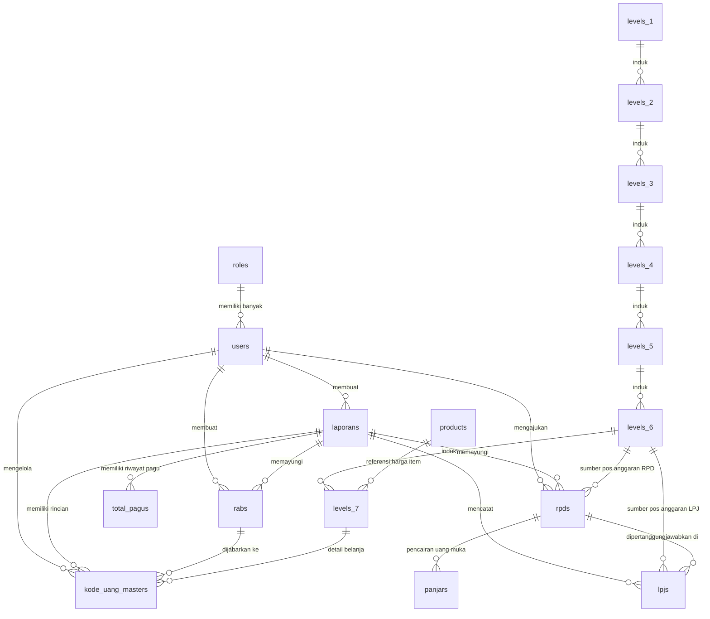

# Dokumentasi Skema & Relasi Database `service-fatek-untad`

Dokumen ini menjelaskan kegunaan masing-masing tabel dan bagaimana tabel-tabel tersebut saling terhubung pada sistem pengelolaan keuangan Fatek Untad.

---

## 1. Analogi Sederhana Alur Sistem

Agar mudah dipahami, bayangkan sistem ini seperti proses keuangan di fakultas:
1. **User & Role**: Karyawan/dosen yang memegang tugas (Admin, Pimpinan, Staf).
2. **Levels 1 s/d 7**: Nomor rekening/pos anggaran bertingkat (seperti pohon/folder: *Fakultas* → *Jurusan* → *Program Kerja* → *Kegiatan* → *Item Barang*).
3. **Product**: Katalog harga satuan barang/jasa standar.
4. **Laporan & Total Pagu**: Dompet utama tahun anggaran (menyimpan total dana BOPTN dan BLU).
5. **RAB & Kode Uang Master**: Buku rencana pembagian jatah uang ke masing-masing kegiatan.
6. **RPD (Rencana Penarikan Dana)**: Surat permohonan pengambilan uang muka/anggaran.
7. **Panjar**: Bukti pemberian uang muka ke pemohon.
8. **LPJ**: Bukti nota/kuitansi pertanggungjawaban setelah uang digunakan.

---

## 2. Diagram Relasi Database (ERD)

---

## 3. Penjelasan Lengkap Tiap Tabel

### A. Modul Pengguna & Hak Akses
1. **`roles`**
   - **Kegunaan**: Menyimpan daftar peran pengguna (misal: Admin, Verifikator, User Pengusul).
   - **Relasi**:
     - *One-to-Many* ke `users` (Satu role dimiliki banyak pengguna).

2. **`users`**
   - **Kegunaan**: Menyimpan data akun pengguna sistem, mencakup email, username, password hash, dan status aktif.
   - **Relasi**:
     - Relasi ke `roles` via `role_id`.
     - *One-to-Many* ke `laporans`, `rabs`, `rpds`, dan `kode_uang_masters` (sebagai pembuat/pemilik data).

---

### B. Modul Pos & Kode Anggaran (Hierarki Level 1 s/d 7)
Struktur kode anggaran menggunakan sistem hierarki (pohon) 7 tingkat:

1. **`levels_1`**: Level tertinggi (misal: Kode Akun Makro/Fakultas).
2. **`levels_2`**: Turunan dari Level 1 (misal: Kelompok Belanja).
3. **`levels_3`**: Turunan dari Level 2 (misal: Jurusan/Program).
4. **`levels_4`**: Turunan dari Level 3 (misal: Kegiatan Utama).
5. **`levels_5`**: Turunan dari Level 4 (misal: Sub-Kegiatan).
6. **`levels_6`**: 
   - **Kegunaan**: Pos anggaran spesifik yang menjadi acuan pengajuan **RPD** dan pelaporan **LPJ**.
   - **Relasi**: Terhubung ke `rpds` dan `lpjs`.
7. **`levels_7`**: 
   - **Kegunaan**: Rincian teknis komponen belanja barang/jasa (volume, kuantiti, harga satuan, nilai TKDN, berkas data dukung).
   - **Relasi**: Terhubung opsional ke `products` (`id_product`).
8. **`products`**: 
   - **Kegunaan**: Standar harga/katalog barang & jasa satuan (SBU) untuk memudahkan pengisian item pada `levels_7`.

*Catatan Relasi Antar-Level*: Setiap level di bawahnya menyimpan foreign key berjenjang dengan aturan `ON DELETE CASCADE`.

---

### C. Modul Perencanaan & Pagu Anggaran
1. **`laporans`**
   - **Kegunaan**: Menyimpan payung tahun anggaran (periode tahun, pagu total BOPTN, sisa pagu BOPTN, pagu BLU, sisa pagu BLU).
   - **Relasi**: Menjadi induk (*One-to-Many*) untuk `total_pagus`, `rabs`, `rpds`, `lpjs`, dan `kode_uang_masters`.

2. **`total_pagus`**
   - **Kegunaan**: Catatan riwayat penyesuaian/revisi pagu awal, pagu revisi BOPTN/BLU, sisa pagu, dan total realisasi per laporan.
   - **Relasi**: Menginduk ke `laporans` via `id_laporan`.

3. **`rabs`** (Rencana Anggaran Biaya)
   - **Kegunaan**: Pengelompokan paket rencana anggaran yang dibuat oleh pengguna untuk tahun anggaran berjalan.
   - **Relasi**: Menginduk ke `users` (`id_user`) dan `laporans` (`id_laporan`).

4. **`kode_uang_masters`**
   - **Kegunaan**: Matriks pemetaan utama yang menggabungkan seluruh hierarki anggaran (`levels_1` s/d `levels_7`) dengan suatu `rabs` dan `laporans`. Menyimpan data pagu awal, revisi, realisasi, dan sisa pagu per mata anggaran kegiatan.
   - **Relasi**: Terhubung ke `users`, `laporans`, `rabs`, dan seluruh tabel `levels_1` sampai `levels_7`.

---

### D. Modul Realisasi, Pengambilan & Pertanggungjawaban Uang
1. **`rpds`** (Rencana Penarikan Dana)
   - **Kegunaan**: Pengajuan pencairan dana oleh user pada kegiatan tertentu (`levels_6`) sebelum pelaksanaan acara/belanja.
   - **Kolom Utama**: `status` (e.g. WAITING, APPROVED), `uang_diambil`, `tanggal_rpd`.
   - **Relasi**: Menginduk ke `laporans`, `levels_6`, dan `users`. Berelasi ke `panjars` dan `lpjs`.

2. **`panjars`**
   - **Kegunaan**: Pencatatan uang muka (panjar) yang diserahkan berdasarkan RPD yang disetujui.
   - **Relasi**: Menginduk langsung ke `rpds` via `id_rpd`.

3. **`lpjs`** (Laporan Pertanggungjawaban)
   - **Kegunaan**: Bukti pertanggungjawaban realisasi dana beserta unggahan kuitansi/dokumen (`src_lpj`), nominal riil terpakai, dan status verifikasi.
   - **Relasi**: Terhubung ke `rpds` (`id_rpd`), `levels_6` (`id_level_6`), dan `laporans` (`id_laporan`).
