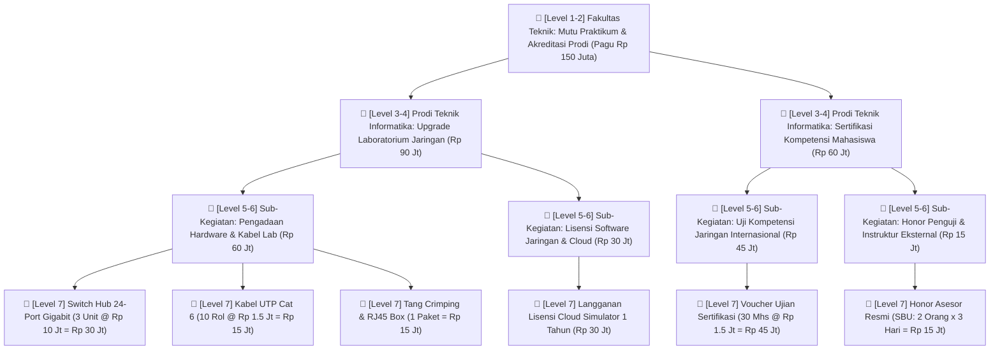

# Contoh Studi Kasus: Pohon Anggaran (Budget Tree) Kampus

---

## 1. Analogi Sederhana di Dunia Kampus

Pikirkan struktur anggaran kampus seperti sebuah pohon bertingkat:

```
[Akar / Batang]   -->  Level 1-2: Fakultas Teknik & Tujuan Strategis (Outcome Utama)
       ↓
[Dahan / Cabang]  -->  Level 3-4: Jurusan / Prodi & Program Kerja (Misal: Penguatan Praktikum Lab)
       ↓
    [Ranting]     -->  Level 5-6: Sub-Kegiatan & Pos Akun Beban (Tempat Pengajuan RPD/LPJ)
       ↓
  [Daun / Buah]   -->  Level 7: Item Belanja Riil (Harga satuan barang/jasa dari katalog SBU)
```

> **Intinya:** Setiap lembar daun (rupiah yang dibelanjakan jurusan) harus menempel pada ranting dan dahan yang sah. Jika dosen atau staf mengajukan pembelian barang yang tidak ada kaitannya dengan dahan program kerja, pengajuan RPD tersebut otomatis **ditolak oleh verifikator keuangan fakultas**.

---

## 2. Studi Kasus Nyata Kampus

- **Unit Kerja:** Jurusan Teknik Informatika — Fakultas Teknik
- **Sumber Dana:** Pagu BLU (Uang Kuliah / Jasa Layanan) & BOPTN
- **Total Alokasi Pagu:** Rp 150.000.000
- **Tujuan Utama (Batang):** Peningkatan Mutu Akreditasi Lab & Layanan Praktikum Mahasiswa Semester Ganjil.

---

## 3. Visualisasi Pohon Anggaran (Hierarki Level 1 - 7)



---

## 4. Tabel Rincian Anggaran (Sesuai Struktur Kasidoi)

| Kode Level | Struktur Anggaran / Komponen | Pagu / Biaya (Rp) | Sumber Dana | Keterangan |
| :--- | :--- | :--- | :--- | :--- |
| **Level 1** | **Fakultas Teknik** | **Rp 150.000.000** | BLU / BOPTN | Unit Utama |
| **Level 2** | *Program Peningkatan Layanan Akademik & Lab* | - | - | Sasaran Strategis |
| **Level 3** | **Jurusan Teknik Informatika** | **Rp 150.000.000** | - | Unit Pengelola Anggaran |
| **Level 4 (A)** | **Program: Modernisasi Lab Komputer Jaringan** | **Rp 90.000.000** | - | Sub-Program A |
| ↳ *Level 5-6* | *Akun 52: Pengadaan Alat Praktikum Jaringan* | *Rp 60.000.000* | BLU | Akun Pengajuan RPD |
| &nbsp;&nbsp;&nbsp;&nbsp;↳ Level 7 | Switch Hub 24-Port Managed (3 unit) | Rp 30.000.000 | BLU | Katalog SBU / TKDN |
| &nbsp;&nbsp;&nbsp;&nbsp;↳ Level 7 | Kabel UTP Cat 6 Schneider (10 rol) | Rp 15.000.000 | BLU | Bahan Habis Pakai |
| &nbsp;&nbsp;&nbsp;&nbsp;↳ Level 7 | Toolkit Jaringan (Crimping, Tester, RJ45) | Rp 15.000.000 | BLU | Peralatan Lab |
| ↳ *Level 5-6* | *Akun 52: Lisensi Software & Lab Virtual* | *Rp 30.000.000* | BLU | Akun Pengajuan RPD |
| &nbsp;&nbsp;&nbsp;&nbsp;↳ Level 7 | Akun Lab Virtual Jaringan (Akses 1 Thn) | Rp 30.000.000 | BLU | Layanan Cloud Edukasi |
| **Level 4 (B)** | **Program: Sertifikasi Mahasiswa Siap Kerja** | **Rp 60.000.000** | - | Sub-Program B |
| ↳ *Level 5-6* | *Akun 53: Uji Kompetensi Mahasiswa Tingkat Akhir* | *Rp 45.000.000* | BOPTN | Akun Pengajuan RPD |
| &nbsp;&nbsp;&nbsp;&nbsp;↳ Level 7 | Voucher Ujian Sertifikasi (30 mahasiswa) | Rp 45.000.000 | BOPTN | Biaya Registrasi Resmi |
| ↳ *Level 5-6* | *Akun 51: Honorarium Narasumber/Asesor* | *Rp 15.000.000* | BOPTN | Akun Pengajuan RPD |
| &nbsp;&nbsp;&nbsp;&nbsp;↳ Level 7 | Honor Penguji Eksternal (Sesuai SBU) | Rp 15.000.000 | BOPTN | Honorarium Resmi |
| **TOTAL** | **Pagu Terpakai (Sisa Pagu: Rp 0)** | **Rp 150.000.000** | **100%** | Sesuai Alokasi DIPA |

---

## 5. Hubungan dengan Alur Kasidoi (RPD & LPJ)

1. **Pengajuan RPD (Rencana Penarikan Dana):**
   - RPD diajukan oleh Kepala Lab / Jurusan di **Level 6** dengan memilih rincian barang di **Level 7**.
   - Sistem akan mengecek: *Apakah kuota sisa pagu di Level 4 masih mencukupi?* Jika cukup, pengajuan diteruskan ke Verifikator.
2. **Uji Relevansi Pohon Anggaran:**
   - *Contoh Kasus Ditolak:* Jurusan mengajukan pembelian "AC Ruang Dosen Rp 8 Juta" menggunakan ranting akun *Praktikum Mahasiswa*. Verifikator langsung menolak karena belanja tersebut tidak sejalan dengan tujuan dahan program kerja praktikum.
3. **LPJ (Laporan Pertanggungjawaban):**
   - Bukti kuitansi/nota riil diunggah untuk mencocokkan barang yang dibeli (Level 7) dengan uang yang dicairkan dari pagu Level 6.
